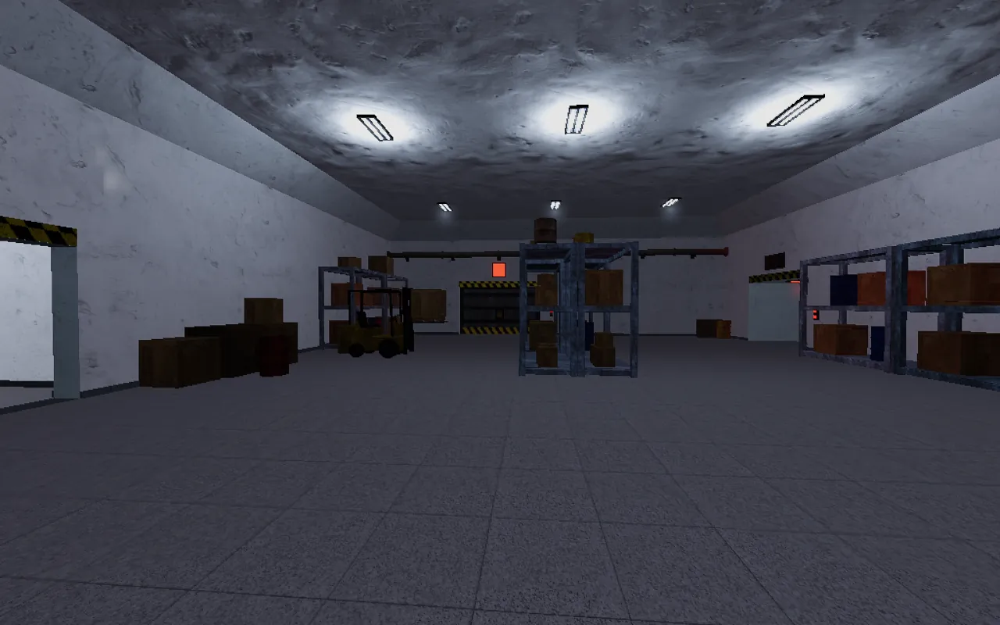
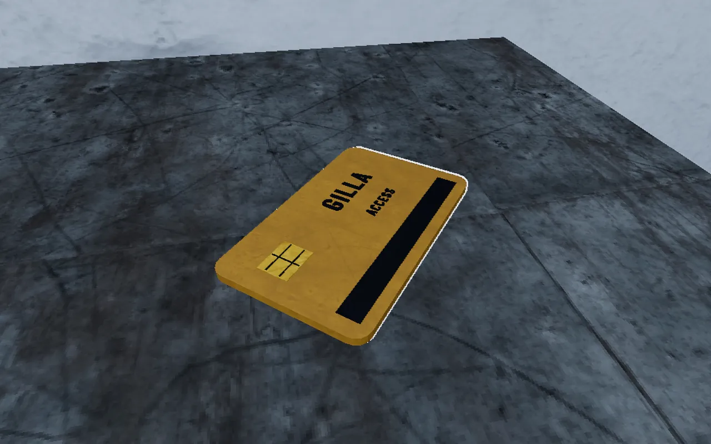
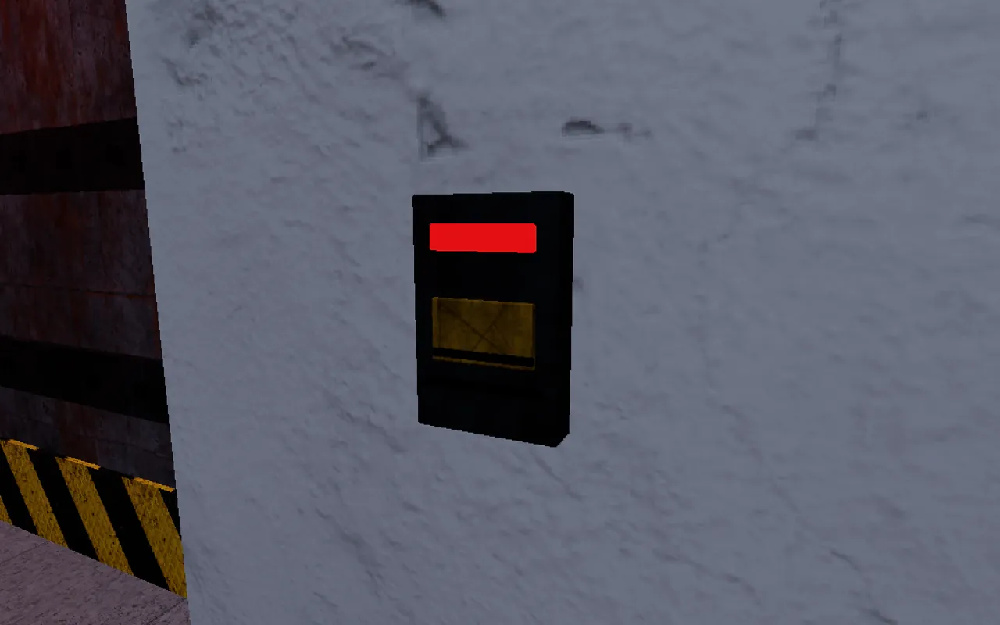
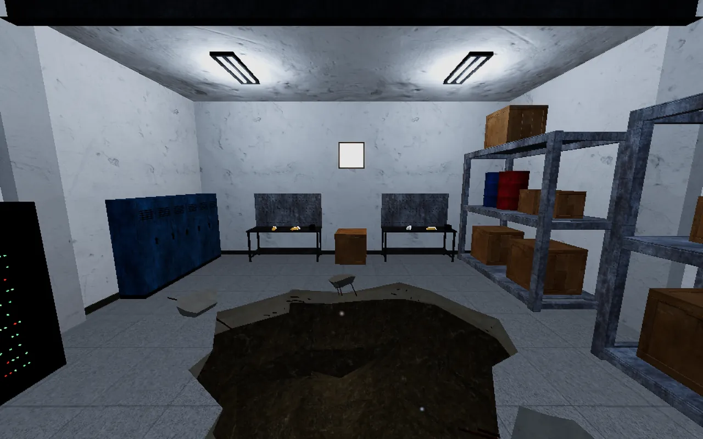

**The Base** ist die Hauptkarte von GILLA: eine riesige verlassene Basis, die du mit anderen Spielern erkundest. Du suchst **Goldbarren** und **Diamanten** und trägst sie zum **Recycler** zurück. Irgendwo gibt es eine **Schlüsselkarte auf einem Schreibtisch**, einen **Kartenleser** an einer **Tür mit Warnstreifen**, einen **Tresorraum** und weitere Ebenen **darunter**, wo The Mannequin jagt. Die offizielle Website fasst es in vier Wörtern zusammen: „Es kann dich hören.“

## So läuft eine Runde in The Base {#how-a-round-in-the-base-goes}

Die offizielle Website nennt The Base „das Hauptspiel“ und gibt die Reihenfolge vor. Zusammengefasst:

1. **Erkunde mit den anderen Spielern** und such, was sich zu tragen lohnt: Goldbarren und Diamanten.
2. **Trag es zum Recycler zurück.** Das ist das Hauptziel. Siehe [Beute und der Recycler](/de/guides/recycler-and-keycard/#the-recycler).
3. **Bleib leise.** „Monster kommen zum Geräusch von Stimmen, also kann dich das, was du im Sprachchat sagst, verraten.“ [The Grinner](/de/guides/monsters/#the-grinner) jagt in den Gängen.
4. **Finde die Schlüsselkarte** und **bring sie zum Kartenleser**, um durch die verschlossene Tür zu kommen. Siehe [die Schlüsselkarte und die verschlossene Tür](/de/guides/recycler-and-keycard/#the-keycard-and-the-locked-door).
5. **Dann klettere hinunter, wenn du willst.** Unten jagt [The Mannequin](/de/guides/monsters/#the-mannequin).

Der Rat der Website für diesen letzten Teil: „Bring Leute mit. Zusammen ist es schlimmer.“ Wenn du mit Freunden statt mit Fremden spielen willst, richte vorher einen [privaten Raum](/de/guides/play-with-friends/#private-room) ein.

## Wichtige Orte {#points-of-interest}

Das sind die Orte, die die offizielle GILLA-Website nennt oder zeigt. Orte in The Base, die wir nicht bestätigt haben, sind nicht aufgeführt.

| Ort | Was wir wissen | Mehr dazu |
| --- | --- | --- |
| Recycler | Hierhin trägst du Goldbarren und Diamanten | [Der Recycler](/de/guides/recycler-and-keycard/#the-recycler) |
| Schlüsselkarte | Laut Website liegt sie „auf einem Schreibtisch“; der Screenshot zeigt eine Karte auf einem Betonboden | [Schlüsselkarte und Tür](/de/guides/recycler-and-keycard/#the-keycard-and-the-locked-door) |
| Kartenleser | An der Wand neben einer Tür mit Warnstreifen | [Schlüsselkarte und Tür](/de/guides/recycler-and-keycard/#the-keycard-and-the-locked-door) |
| Türen mit Warnstreifen | Türen mit gelb-schwarzen Streifen; eine liegt am Ende eines rot beleuchteten Gangs | [So sieht The Base aus](#what-the-base-looks-like) |
| Lagerräume | Dunkle Räume mit Regalen und Kisten | [So sieht The Base aus](#what-the-base-looks-like) |
| Tresorraum | Auf der offiziellen Website als Teil von The Base genannt | Noch nicht bestätigt |
| Der Weg nach unten | Die Website zeigt neben „Dann klettere hinunter“ ein gezacktes Loch im Boden eines Lagerraums | [Unter The Base](#under-the-base) |

## So sieht The Base aus {#what-the-base-looks-like}

Das sind offizielle Screenshots von der GILLA-Website, mit den offiziellen Beschreibungen. Sie zeigen, worauf du achten solltest, aber nicht, wo die Dinge sind: Die Website sagt nicht, in welchem Raum welches Bild entstanden ist.

*Ein dunkler Lagerraum in der Basis, mit Regalen und Kisten. Screenshot © Play Gilla.*

*Eine goldene GILLA-Schlüsselkarte auf einem Betonboden: golden, mit dem GILLA-Namen und einem schwarzen Streifen. Screenshot © Play Gilla.*

*Ein Kartenleser an der Wand neben einer Tür mit Warnstreifen. Oben hat er ein rotes Licht. Screenshot © Play Gilla.*

*Ein gezacktes Loch im Boden eines Lagerraums, gezeigt mit dem offiziellen Satz „Dann klettere hinunter, wenn du willst.“ Screenshot © Play Gilla.*

## Über und unter der verschlossenen Tür {#above-and-below-the-locked-door}

**Über der Tür** erkundest du, sammelst und trägst Beute zum Recycler. Das ist der „sicherere“ Teil der Karte, aber [The Grinner](/de/guides/monsters/#the-grinner) jagt trotzdem dort und kommt, wenn du in seiner Nähe redest.

**Unter der Tür** ist laut offizieller Website der Ort, an dem „die Räume keinen Sinn mehr ergeben“. Dort jagt [The Mannequin](/de/guides/monsters/#the-mannequin): drei Meter rissige, blasse Hülle, ohne Arme und ohne Gesicht. Das Hinunterklettern ist freiwillig.

Unsere Vorschläge, bevor du hinuntergehst:

- **Liefere zuerst deine Beute ab**, damit ein schlechter Ausflug nach unten dich nicht kostet, was du schon gefunden hast.
- **Geht als Gruppe hinunter** und vereinbart einen Weg zurück nach oben.
- **Geh davon aus, dass es dich auch hört.** Die Website sagt nicht, was The Mannequin anlockt, aber Monster in GILLA kommen zum Geräusch von Stimmen.

## Unter The Base {#under-the-base}

Wir veröffentlichen keinen Plan der unteren Ebenen, bevor wir sie im Spiel geprüft haben, weil Early-Access-Updates sie verändern können. Die offizielle Website beschreibt die Räume dort unten nicht, nur dass sie „keinen Sinn mehr ergeben“.

## Was wir noch nicht bestätigt haben {#what-we-havent-confirmed-yet}

Die offizielle Website sagt es nicht, und wir haben es noch nicht im Spiel geprüft:

- in welchem Raum der Schreibtisch mit der Schlüsselkarte steht und ob die Karte immer dort beginnt;
- wo der Recycler ist und was er dir für Goldbarren und Diamanten gibt;
- wo Goldbarren und Diamanten erscheinen und was sie jeweils wert sind;
- was im Tresorraum ist und wie man ihn öffnet;
- wie lange eine Runde dauert;
- was The Mannequin anlockt und wie schnell es ist.

Wir ergänzen jeden Punkt, sobald er bestätigt ist, mit der Spielversion, in der wir ihn geprüft haben.

## Monster auf dieser Karte {#monsters-on-this-map}

- **In The Base:** [The Grinner](/de/guides/monsters/#the-grinner). Er kommt zum Geräusch von Stimmen.
- **Unter The Base:** [The Mannequin](/de/guides/monsters/#the-mannequin). Es jagt auf den unteren Ebenen.

Um alle drei Modi zu vergleichen und zu sehen, was dich in welchem jagt, nutze die [Übersicht zu Modi und Monstern](/de/guides/game-modes/).

## Andere Karten {#other-maps}

- **Don't Splash** wird in einer **gefluteten Halle** mit sinkenden Plattformen gespielt. Siehe [Don't Splash](/de/guides/dont-splash/).
- **Be the Monster** beginnt mit einer **Kartenabstimmung**, wird also auf mehr als einer Karte gespielt. Siehe [Be the Monster](/de/guides/be-the-monster/).

## Warum es hier keine Kartengrafik gibt {#why-there-is-no-map-image-here}

Die Fan-Content-Regeln von Play Gilla verbieten Rippen, Data-Mining und KI-Kopien der Karten des Spiels, und Play Gilla hat keine offizielle Karte veröffentlicht. Eine Karte hier könnte nur aus unserer eigenen Zeichnung von dem stammen, was wir im Spiel geprüft haben. Wir ergänzen sie, sobald wir The Base selbst kartiert haben. Screenshots sind in Guides und Wikis erlaubt, deshalb siehst du oben die offiziellen.

Nächster Schritt: Mach deinen [ersten Beutezug und öffne die Tür mit der Schlüsselkarte](/de/guides/recycler-and-keycard/).
