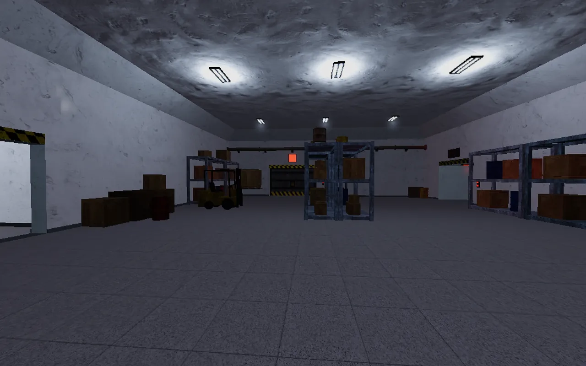
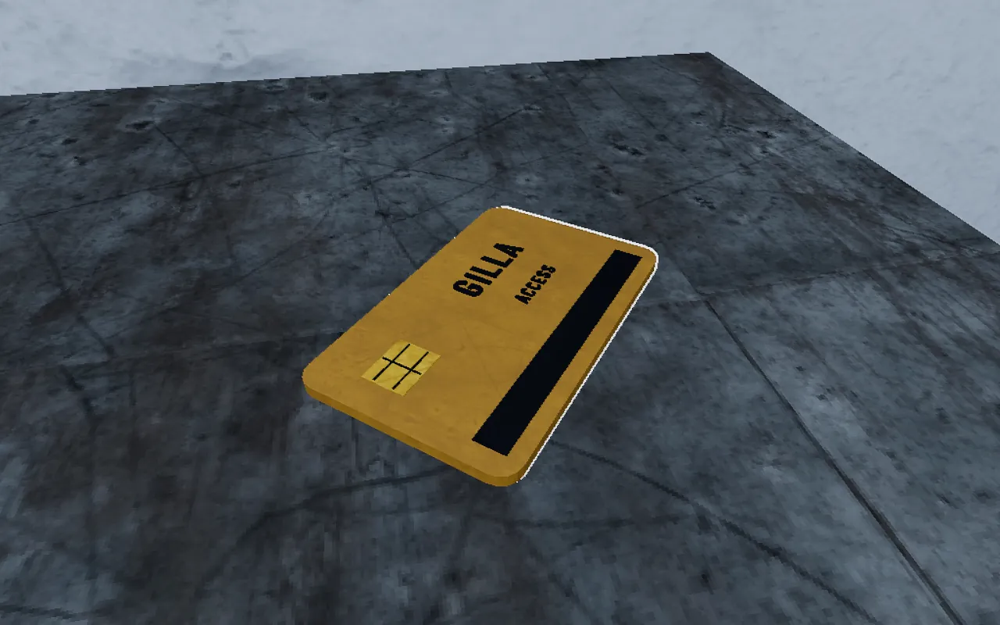
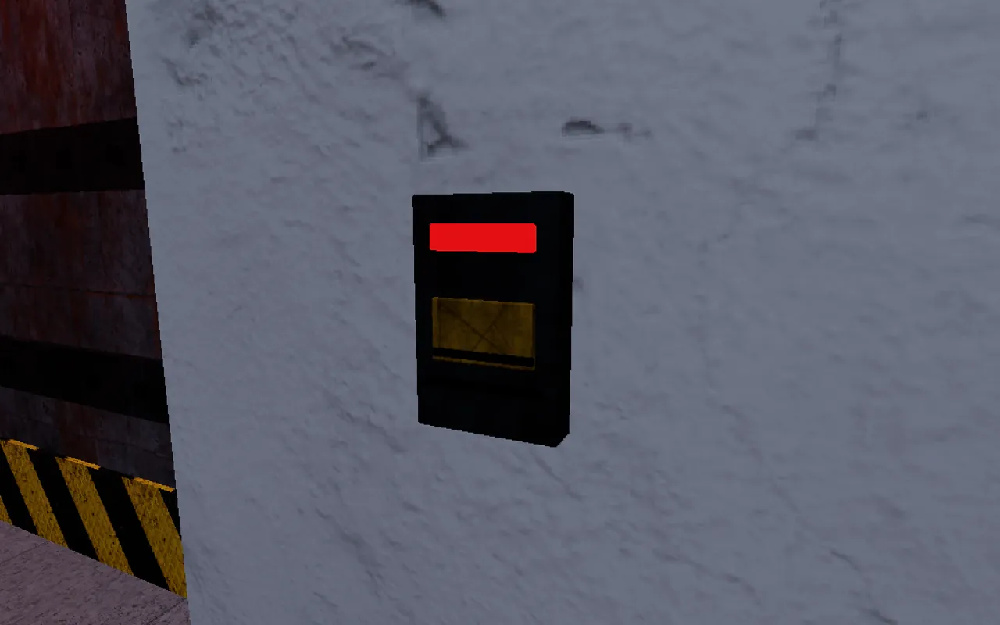
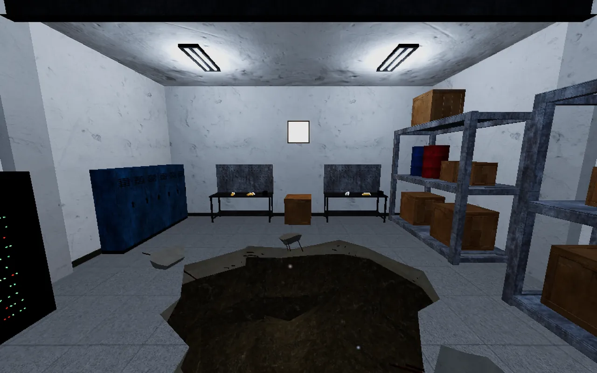

**The Base** is GILLA's main map: a huge abandoned base you explore with other players. You hunt for **gold bars** and **diamonds** and carry them back to the **recycler**. Somewhere there's a **keycard on a desk**, a **card reader** by a **hazard door**, a **vault**, and more levels **underneath**, where the Mannequin hunts. The official site sums it up in four words: "It can hear you."

## How a round in the Base goes

The official site describes the Base as "the main game" and gives the order of things. Put together:

1. **Explore with the other players** and look for what's worth carrying: gold bars and diamonds.
2. **Carry it back to the recycler.** That's the main goal. See [loot and the recycler](/guides/recycler-and-keycard/#the-recycler).
3. **Keep your voice down.** "Monsters come to the sound of talking, so what you say on voice chat can get you caught." The [Grinner](/guides/monsters/#the-grinner) hunts the halls.
4. **Find the keycard** and **take it to the reader** to get past the locked door. See [the keycard and the locked door](/guides/recycler-and-keycard/#the-keycard-and-the-locked-door).
5. **Then climb down, if you want to.** Below is where the [Mannequin](/guides/monsters/#the-mannequin) hunts.

The site's advice for that last part is "Bring people. It's worse together." To play with friends instead of strangers, set up a [private room](/guides/play-with-friends/#private-room) first.

## Points of interest

These are the places the official GILLA site names or shows. Locations inside the Base that we haven't confirmed are not listed.

| Place | What we know | Read more |
| --- | --- | --- |
| Recycler | Where you carry gold bars and diamonds | [The recycler](/guides/recycler-and-keycard/#the-recycler) |
| Keycard | The site says it's "on a desk"; its screenshot shows a keycard on a concrete floor | [Keycard and locked door](/guides/recycler-and-keycard/#the-keycard-and-the-locked-door) |
| Card reader | On the wall by a hazard door | [Keycard and locked door](/guides/recycler-and-keycard/#the-keycard-and-the-locked-door) |
| Hazard doors | Doors marked with yellow and black stripes; one sits at the end of a red-lit hall | [What the Base looks like](#what-the-base-looks-like) |
| Storerooms | Dark rooms with shelves and crates | [What the Base looks like](#what-the-base-looks-like) |
| Vault | Named on the official site as part of the Base | Not yet confirmed |
| The way down | The site shows a jagged hole torn through a storeroom floor next to "Then climb down" | [Under the Base](#under-the-base) |

## What the Base looks like

These are official screenshots from the GILLA website, with the official descriptions. They show what to look out for, not where things are: the site doesn't say which room each one is in.

*A dark storeroom in the base, with shelves and crates. Screenshot © Play Gilla.*

*A gold GILLA keycard on a concrete floor: gold, with the GILLA name and a black stripe. Screenshot © Play Gilla.*

*A card reader on the wall by a hazard door. It has a red light at the top. Screenshot © Play Gilla.*

*A jagged hole torn through a storeroom floor, shown with the official line "Then climb down, if you want to." Screenshot © Play Gilla.*

## Above and below the locked door

**Above the door** is where you explore, collect and carry loot to the recycler. It's the "safer" part of the map, but the [Grinner](/guides/monsters/#the-grinner) still hunts there and comes when you talk near it.

**Below the door**, the official site says, is where "the rooms stop making sense." That is where the [Mannequin](/guides/monsters/#the-mannequin) hunts: three metres of cracked, pale shell, with no arms and no face. Climbing down is optional.

Our suggestions before you go below:

- **Drop off your loot first** at the recycler, so a bad trip down doesn't cost you what you already found.
- **Go down as a group** and agree on a way back up.
- **Assume it can hear you too.** The site doesn't say what draws the Mannequin, but monsters in GILLA come to the sound of talking.

## Under the Base

We don't publish a layout of the lower levels until we've checked it in-game, because Early Access updates can change it. The official site doesn't describe the rooms down there, only that they "stop making sense."

## What we haven't confirmed yet

The official site doesn't say, and we haven't checked in-game yet:

- which room the keycard desk is in, and whether the keycard always starts there;
- where the recycler is, and what it gives you for gold bars and diamonds;
- where gold bars and diamonds appear, and what each is worth;
- what's in the vault and how to open it;
- how long a round lasts;
- what draws the Mannequin, and how fast it is.

We'll add each one once it's confirmed, with the game version we checked it on.

## Monsters on this map

- **In the Base:** [the Grinner](/guides/monsters/#the-grinner). It comes to the sound of talking.
- **Under the Base:** [the Mannequin](/guides/monsters/#the-mannequin). It hunts on the lower levels.

To compare all three modes and what hunts you in each, use the [modes and monsters finder](/guides/game-modes/).

## Other maps

- **Don't Splash** is played in a **flooded hall** with sinking platforms. See [Don't Splash](/guides/dont-splash/).
- **Be the Monster** starts with a **map vote**, so it is played on more than one map. See [Be the Monster](/guides/be-the-monster/).

## Why there is no map image here

Play Gilla's fan content rules don't allow ripping, data-mining or AI copies of the game's maps, and Play Gilla hasn't published an official map. A map here could only come from our own drawing of what we've checked in-game, so we'll add one once we've mapped the Base ourselves. Screenshots are allowed in guides and wikis, which is why the official ones appear above.

Next step: make your [first loot run and open the keycard door](/guides/recycler-and-keycard/).
