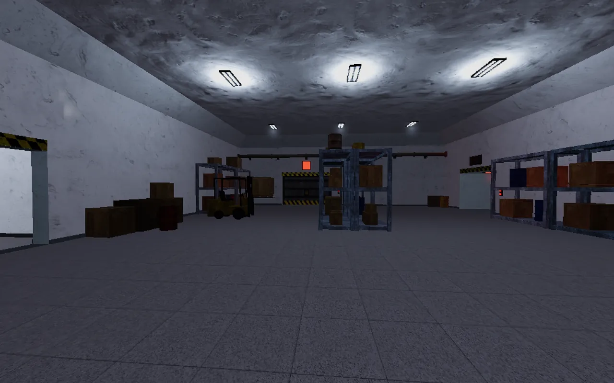
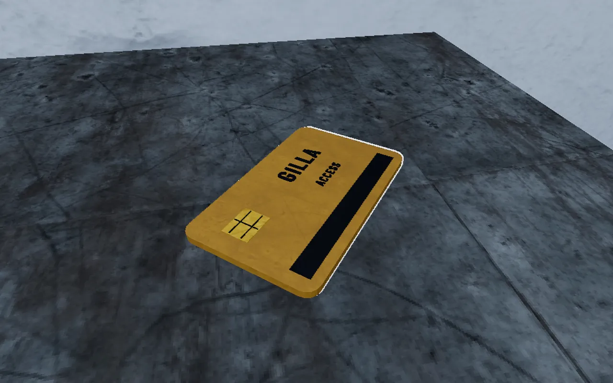
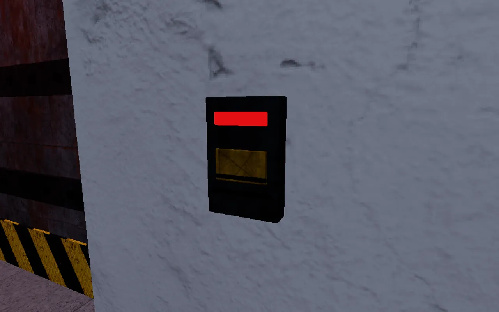
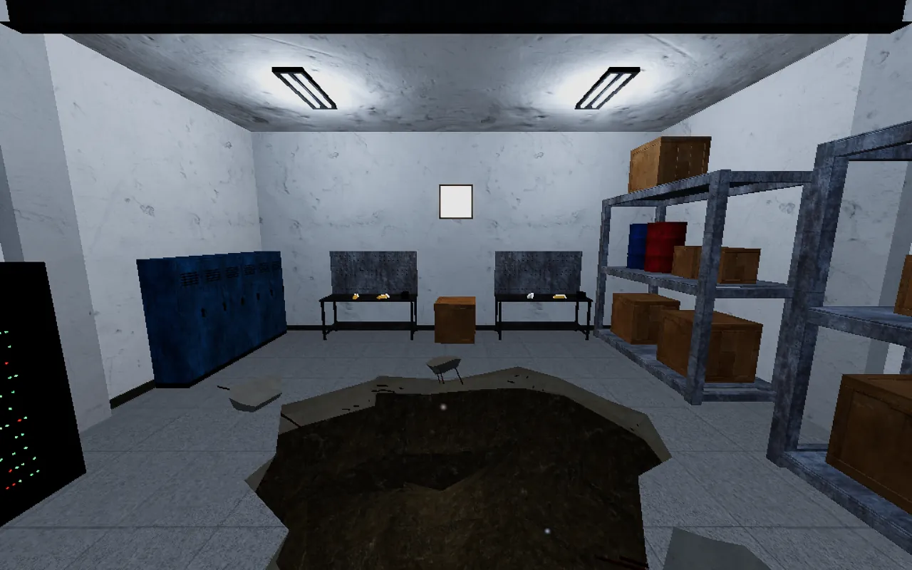

**The Base** es el mapa principal de GILLA: una enorme base abandonada que exploras con otros jugadores. Buscas **lingotes de oro** y **diamantes** y los llevas de vuelta al **reciclador**. En algún lugar hay una **tarjeta de acceso sobre un escritorio**, un **lector de tarjetas** junto a una **puerta con franjas de peligro**, una **cámara acorazada** y más niveles **debajo**, donde caza The Mannequin. El sitio oficial lo resume en tres palabras: «Puede oírte».

## Cómo es una ronda en The Base {#how-a-round-in-the-base-goes}

El sitio oficial describe The Base como «el juego principal» y da el orden de las cosas. En resumen:

1. **Explora con los demás jugadores** y busca lo que merece la pena llevar: lingotes de oro y diamantes.
2. **Llévalo de vuelta al reciclador.** Ese es el objetivo principal. Consulta [el botín y el reciclador](/es/guides/recycler-and-keycard/#the-recycler).
3. **No hables alto.** «Los monstruos acuden al sonido de las voces, así que lo que dices en el chat de voz puede delatarte». [The Grinner](/es/guides/monsters/#the-grinner) caza por los pasillos.
4. **Encuentra la tarjeta de acceso** y **llévala al lector** para pasar la puerta cerrada. Consulta [la tarjeta de acceso y la puerta cerrada](/es/guides/recycler-and-keycard/#the-keycard-and-the-locked-door).
5. **Luego baja, si quieres.** Abajo es donde caza [The Mannequin](/es/guides/monsters/#the-mannequin).

El consejo del sitio para esa última parte es: «Trae gente. Juntos es peor». Si quieres jugar con amigos en vez de con desconocidos, crea antes una [sala privada](/es/guides/play-with-friends/#private-room).

## Puntos de interés {#points-of-interest}

Estos son los lugares que el sitio oficial de GILLA nombra o muestra. No incluimos lugares de The Base que no hayamos confirmado.

| Lugar | Lo que sabemos | Más información |
| --- | --- | --- |
| Reciclador | Adonde llevas los lingotes de oro y los diamantes | [El reciclador](/es/guides/recycler-and-keycard/#the-recycler) |
| Tarjeta de acceso | El sitio dice que está «sobre un escritorio»; su captura muestra una tarjeta en un suelo de hormigón | [Tarjeta y puerta](/es/guides/recycler-and-keycard/#the-keycard-and-the-locked-door) |
| Lector de tarjetas | En la pared, junto a una puerta con franjas de peligro | [Tarjeta y puerta](/es/guides/recycler-and-keycard/#the-keycard-and-the-locked-door) |
| Puertas con franjas de peligro | Puertas marcadas con franjas amarillas y negras; una está al fondo de un pasillo con luz roja | [Cómo es The Base](#what-the-base-looks-like) |
| Almacenes | Salas oscuras con estanterías y cajas | [Cómo es The Base](#what-the-base-looks-like) |
| Cámara acorazada | El sitio oficial la menciona como parte de The Base | Sin confirmar |
| La bajada | El sitio muestra un agujero irregular en el suelo de un almacén junto a «Luego baja» | [Debajo de The Base](#under-the-base) |

## Cómo es The Base {#what-the-base-looks-like}

Estas son capturas oficiales del sitio web de GILLA, con sus descripciones oficiales. Muestran qué buscar, no dónde está cada cosa: el sitio no dice en qué sala se tomó cada una.

*Un almacén oscuro de la base, con estanterías y cajas. Captura © Play Gilla.*

*Una tarjeta de acceso dorada de GILLA en un suelo de hormigón: dorada, con el nombre GILLA y una franja negra. Captura © Play Gilla.*

*Un lector de tarjetas en la pared junto a una puerta con franjas de peligro. Tiene una luz roja arriba. Captura © Play Gilla.*

*Un agujero irregular abierto en el suelo de un almacén, mostrado junto a la frase oficial «Luego baja, si quieres». Captura © Play Gilla.*

## Por encima y por debajo de la puerta cerrada {#above-and-below-the-locked-door}

**Por encima de la puerta** es donde exploras, recoges y llevas el botín al reciclador. Es la parte «más segura» del mapa, pero [The Grinner](/es/guides/monsters/#the-grinner) también caza ahí y acude cuando hablas cerca de él.

**Por debajo de la puerta**, según el sitio oficial, es donde «las salas dejan de tener sentido». Ahí caza [The Mannequin](/es/guides/monsters/#the-mannequin): tres metros de caparazón pálido y agrietado, sin brazos y sin cara. Bajar es opcional.

Nuestras sugerencias antes de bajar:

- **Deja primero tu botín** en el reciclador, para que una mala bajada no te cueste lo que ya encontraste.
- **Bajad en grupo** y acordad una forma de volver a subir.
- **Da por hecho que también te oye.** El sitio no dice qué atrae a The Mannequin, pero los monstruos de GILLA acuden al sonido de las voces.

## Debajo de The Base {#under-the-base}

No publicamos un plano de los niveles inferiores hasta comprobarlo en el juego, porque las actualizaciones del acceso anticipado pueden cambiarlo. El sitio oficial no describe las salas de abajo, solo que «dejan de tener sentido».

## Lo que aún no hemos confirmado {#what-we-havent-confirmed-yet}

El sitio oficial no lo dice, y todavía no lo hemos comprobado en el juego:

- en qué sala está el escritorio de la tarjeta y si la tarjeta empieza siempre ahí;
- dónde está el reciclador y qué te da por los lingotes de oro y los diamantes;
- dónde aparecen los lingotes de oro y los diamantes, y cuánto vale cada uno;
- qué hay en la cámara acorazada y cómo se abre;
- cuánto dura una ronda;
- qué atrae a The Mannequin y qué velocidad tiene.

Añadiremos cada punto en cuanto esté confirmado, con la versión del juego en la que lo comprobamos.

## Monstruos en este mapa {#monsters-on-this-map}

- **En The Base:** [The Grinner](/es/guides/monsters/#the-grinner). Acude al sonido de las voces.
- **Debajo de The Base:** [The Mannequin](/es/guides/monsters/#the-mannequin). Caza en los niveles inferiores.

Para comparar los tres modos y ver qué te caza en cada uno, usa el [buscador de modos y monstruos](/es/guides/game-modes/).

## Otros mapas {#other-maps}

- **Don't Splash** se juega en una **sala inundada** con plataformas que se hunden. Consulta [Don't Splash](/es/guides/dont-splash/).
- **Be the Monster** empieza con una **votación de mapa**, así que se juega en más de un mapa. Consulta [Be the Monster](/es/guides/be-the-monster/).

## Por qué no hay una imagen del mapa {#why-there-is-no-map-image-here}

Las normas de contenido de fans de Play Gilla no permiten extraer archivos, hacer minería de datos ni copiar con IA los mapas del juego, y Play Gilla no ha publicado un mapa oficial. Un mapa aquí solo podría salir de nuestro propio dibujo de lo que hayamos comprobado en el juego, así que lo añadiremos cuando hayamos cartografiado The Base nosotros mismos. Las capturas sí están permitidas en guías y wikis, por eso aparecen arriba las oficiales.

Siguiente paso: haz tu [primera ronda de botín y abre la puerta de la tarjeta](/es/guides/recycler-and-keycard/).
