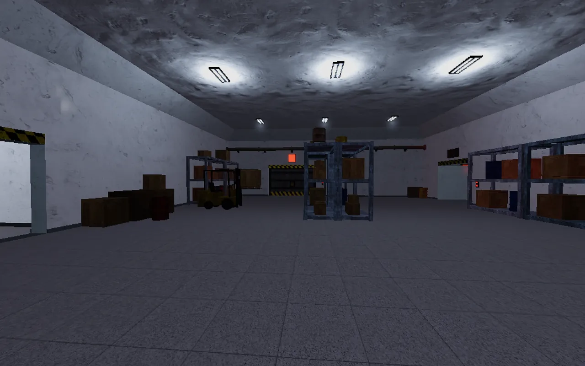
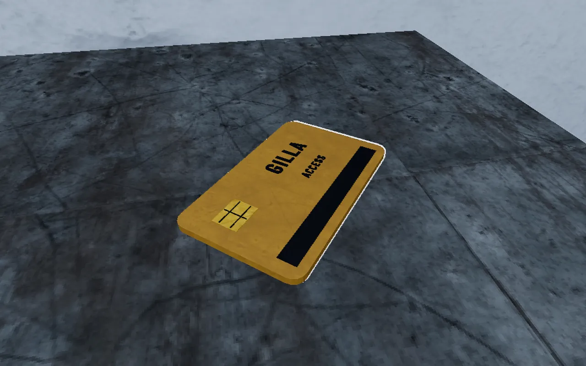
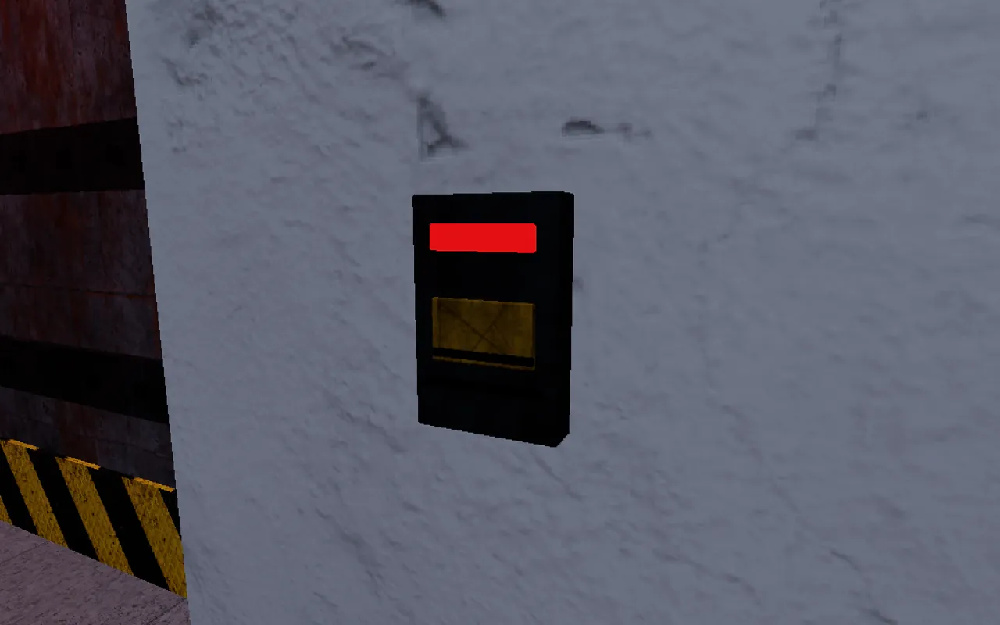
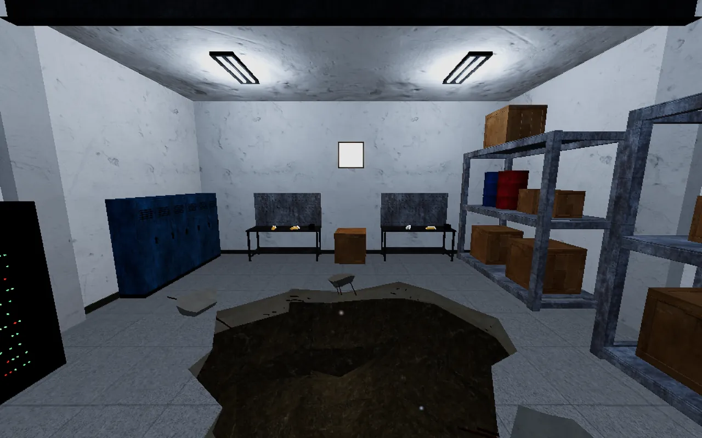

**The Base** est la carte principale de GILLA : une immense base abandonnée que tu explores avec d’autres joueurs. Tu cherches des **lingots d’or** et des **diamants** et tu les rapportes au **recycleur**. Quelque part se trouvent une **carte d’accès posée sur un bureau**, un **lecteur de carte** près d’une **porte à bandes de danger**, une **chambre forte** et d’autres niveaux **en dessous**, où chasse The Mannequin. Le site officiel le résume en quatre mots : « Il peut t’entendre. »

## Déroulement d’une partie dans The Base {#how-a-round-in-the-base-goes}

Le site officiel présente The Base comme « le jeu principal » et donne l’ordre des choses. En résumé :

1. **Explore avec les autres joueurs** et cherche ce qui vaut la peine d’être porté : lingots d’or et diamants.
2. **Rapporte-le au recycleur.** C’est l’objectif principal. Voir [le butin et le recycleur](/fr/guides/recycler-and-keycard/#the-recycler).
3. **Parle à voix basse.** « Les monstres viennent au son des voix, donc ce que tu dis dans le chat vocal peut te faire repérer. » [The Grinner](/fr/guides/monsters/#the-grinner) chasse dans les couloirs.
4. **Trouve la carte d’accès** et **apporte-la au lecteur** pour passer la porte verrouillée. Voir [la carte d’accès et la porte verrouillée](/fr/guides/recycler-and-keycard/#the-keycard-and-the-locked-door).
5. **Puis descends, si tu veux.** C’est en bas que chasse [The Mannequin](/fr/guides/monsters/#the-mannequin).

Le conseil du site pour cette dernière étape : « Amène du monde. C’est pire à plusieurs. » Pour jouer avec des amis plutôt qu’avec des inconnus, crée d’abord une [salle privée](/fr/guides/play-with-friends/#private-room).

## Lieux importants {#points-of-interest}

Voici les lieux que le site officiel de GILLA nomme ou montre. Les lieux de The Base que nous n’avons pas confirmés ne sont pas listés.

| Lieu | Ce que nous savons | En savoir plus |
| --- | --- | --- |
| Recycleur | Là où tu rapportes les lingots d’or et les diamants | [Le recycleur](/fr/guides/recycler-and-keycard/#the-recycler) |
| Carte d’accès | Le site dit qu’elle est « sur un bureau » ; sa capture montre une carte sur un sol en béton | [Carte et porte](/fr/guides/recycler-and-keycard/#the-keycard-and-the-locked-door) |
| Lecteur de carte | Au mur, près d’une porte à bandes de danger | [Carte et porte](/fr/guides/recycler-and-keycard/#the-keycard-and-the-locked-door) |
| Portes à bandes de danger | Des portes marquées de bandes jaunes et noires ; l’une d’elles se trouve au bout d’un couloir éclairé en rouge | [À quoi ressemble The Base](#what-the-base-looks-like) |
| Réserves | Des pièces sombres avec des étagères et des caisses | [À quoi ressemble The Base](#what-the-base-looks-like) |
| Chambre forte | Citée sur le site officiel comme faisant partie de The Base | Pas encore confirmé |
| La descente | Le site montre un trou déchiqueté dans le sol d’une réserve à côté de « Puis descends » | [Sous The Base](#under-the-base) |

## À quoi ressemble The Base {#what-the-base-looks-like}

Voici des captures officielles du site de GILLA, avec leurs descriptions officielles. Elles montrent quoi repérer, pas où se trouvent les choses : le site ne dit pas dans quelle pièce chacune a été prise.

*Une réserve sombre dans la base, avec des étagères et des caisses. Capture © Play Gilla.*

*Une carte d’accès GILLA dorée sur un sol en béton : dorée, avec le nom GILLA et une bande noire. Capture © Play Gilla.*

*Un lecteur de carte au mur, près d’une porte à bandes de danger. Il a une lumière rouge en haut. Capture © Play Gilla.*

*Un trou déchiqueté dans le sol d’une réserve, montré avec la phrase officielle « Puis descends, si tu veux. » Capture © Play Gilla.*

## Au-dessus et en dessous de la porte verrouillée {#above-and-below-the-locked-door}

**Au-dessus de la porte**, tu explores, tu ramasses et tu rapportes le butin au recycleur. C’est la partie « la plus sûre » de la carte, mais [The Grinner](/fr/guides/monsters/#the-grinner) y chasse quand même et vient quand tu parles près de lui.

**En dessous de la porte**, selon le site officiel, c’est là où « les pièces n’ont plus de sens ». C’est là que chasse [The Mannequin](/fr/guides/monsters/#the-mannequin) : trois mètres de coque pâle et fissurée, sans bras et sans visage. Descendre est facultatif.

Nos suggestions avant de descendre :

- **Dépose d’abord ton butin** au recycleur, pour qu’une mauvaise descente ne te coûte pas ce que tu as déjà trouvé.
- **Descendez en groupe** et mettez-vous d’accord sur un moyen de remonter.
- **Pars du principe qu’il t’entend aussi.** Le site ne dit pas ce qui attire The Mannequin, mais les monstres de GILLA viennent au son des voix.

## Sous The Base {#under-the-base}

Nous ne publions pas de plan des niveaux inférieurs avant de les avoir vérifiés en jeu, car les mises à jour de l’accès anticipé peuvent les modifier. Le site officiel ne décrit pas les pièces d’en bas, il dit seulement qu’elles « n’ont plus de sens ».

## Ce que nous n’avons pas encore confirmé {#what-we-havent-confirmed-yet}

Le site officiel ne le dit pas, et nous ne l’avons pas encore vérifié en jeu :

- dans quelle pièce se trouve le bureau de la carte d’accès, et si la carte y commence toujours ;
- où se trouve le recycleur, et ce qu’il donne pour les lingots d’or et les diamants ;
- où apparaissent les lingots d’or et les diamants, et ce que vaut chacun ;
- ce que contient la chambre forte et comment l’ouvrir ;
- combien de temps dure une partie ;
- ce qui attire The Mannequin, et à quelle vitesse il se déplace.

Nous ajouterons chaque point dès qu’il sera confirmé, avec la version du jeu sur laquelle nous l’avons vérifié.

## Monstres sur cette carte {#monsters-on-this-map}

- **Dans The Base :** [The Grinner](/fr/guides/monsters/#the-grinner). Il vient au son des voix.
- **Sous The Base :** [The Mannequin](/fr/guides/monsters/#the-mannequin). Il chasse dans les niveaux inférieurs.

Pour comparer les trois modes et voir ce qui te chasse dans chacun, utilise le [comparateur des modes et des monstres](/fr/guides/game-modes/).

## Autres cartes {#other-maps}

- **Don't Splash** se joue dans une **salle inondée** avec des plateformes qui coulent. Voir [Don't Splash](/fr/guides/dont-splash/).
- **Be the Monster** commence par un **vote de carte**, donc il se joue sur plusieurs cartes. Voir [Be the Monster](/fr/guides/be-the-monster/).

## Pourquoi il n’y a pas d’image de la carte {#why-there-is-no-map-image-here}

Les règles du contenu de fans de Play Gilla interdisent l’extraction de fichiers, le data-mining et les copies par IA des cartes du jeu, et Play Gilla n’a pas publié de carte officielle. Une carte ici ne pourrait venir que de notre propre dessin de ce que nous avons vérifié en jeu, donc nous l’ajouterons quand nous aurons cartographié The Base nous-mêmes. Les captures d’écran sont autorisées dans les guides et les wikis, c’est pourquoi les captures officielles figurent plus haut.

Étape suivante : fais ta [première chasse au butin et ouvre la porte à carte d’accès](/fr/guides/recycler-and-keycard/).
